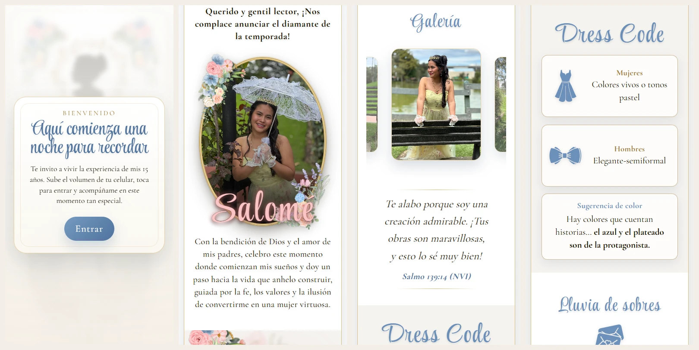

# Los quince de Salomé

[Ir al sitio](https://purplecowd.github.io/salome-XV/)

Una invitación digital para celebrar los quince años de Salomé. La experiencia empieza como una tarjeta que se abre: al tocar **Entrar**, suena la música y aparece el retrato de la festejada junto al mensaje de su familia. Más abajo, los invitados pueden recorrer el álbum, consultar los detalles de la recepción y confirmar su asistencia.

## Del recuerdo a la recepción

La galería reúne nueve fotografías en un carrusel que avanza solo y también se puede recorrer con el dedo. En la misma página, la cuenta regresiva acompaña los datos de la recepción. El botón **Cómo llegar** abre la ubicación en Google Maps. Las ilustraciones del código de vestuario, la sección de lluvia de sobres y el enlace a WhatsApp con un mensaje preparado completan la invitación.

## Diseño e implementación

La composición combina retratos, marcos y ornamentos florales en SVG. **Style Script** da a los títulos el trazo de una invitación manuscrita y **Cormorant Garamond** acompaña los textos de lectura.

La invitación se sirve como una página estática. El [HTML](index.html) define el recorrido y los enlaces a Maps y WhatsApp. La [hoja de estilos](styles.css) adapta la composición a cada pantalla. El comportamiento se reparte entre tres módulos de JavaScript:

- El [reproductor](scripts/music-player.js) vincula la música con la entrada del invitado.
- El [contador](scripts/event-countdown.js) calcula el tiempo restante hasta la celebración.
- El [carrusel](scripts/gallery-carousel.js) duplica la secuencia de fotos para dar continuidad al recorrido y pausa el avance automático durante la interacción.
