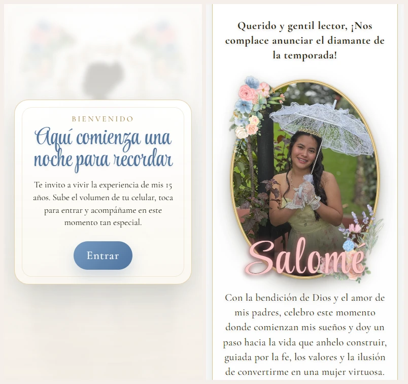
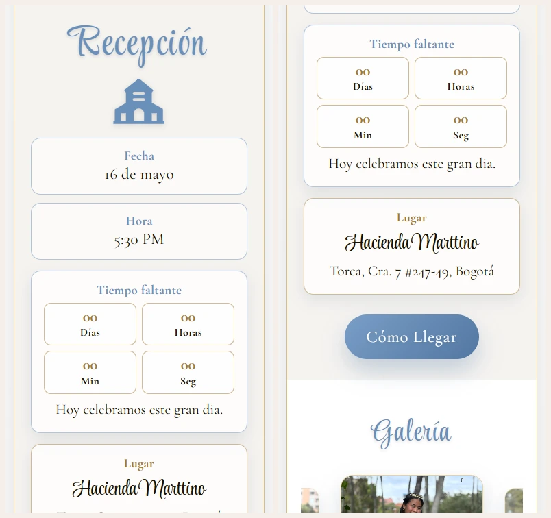
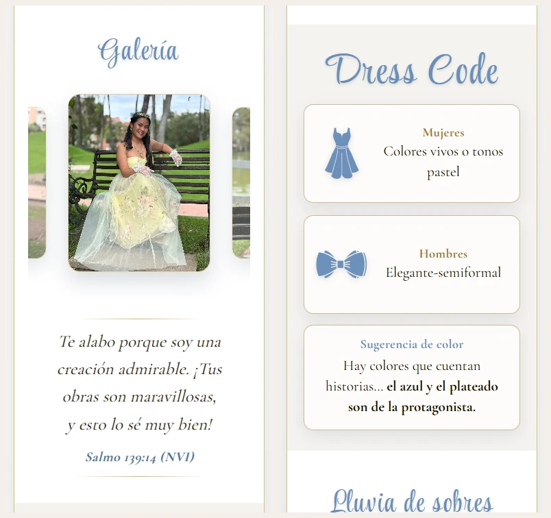
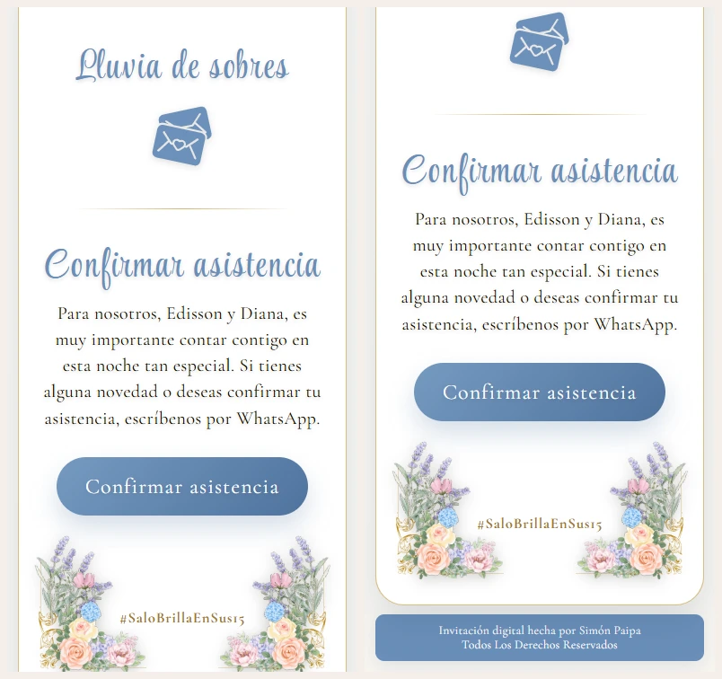

# Tarjeta de invitación a los 15 de Salomé

[Ir al sitio](https://purplecowd.github.io/salome-XV/)

Una invitación digital para celebrar los quince años de Salomé. La experiencia empieza como una tarjeta que se abre: al tocar **Entrar**, suena la música y aparece el retrato de la festejada junto al mensaje de su familia. Más abajo, los invitados pueden recorrer el álbum, consultar los detalles de la recepción y confirmar su asistencia.

  

## Recepción y cuenta regresiva

La invitación reúne la fecha, la ubicación y el acceso a Google Maps. El contador muestra días, horas, minutos y segundos. En la captura aparece en cero porque la recepción ya pasó.

  

## Recuerdos y vestuario

El álbum reúne nueve fotografías en un carrusel que también se puede recorrer con el dedo. Las ilustraciones presentan el código de vestuario.

  

## Confirmación por WhatsApp

Después de la lluvia de sobres, el botón **Confirmar asistencia** abre WhatsApp con un mensaje preparado para la familia.

  

## Diseño e implementación

La composición combina retratos, marcos y ornamentos florales en SVG. **Style Script** da a los títulos el trazo de una invitación manuscrita y **Cormorant Garamond** acompaña los textos de lectura.

La invitación se sirve como una página estática. El [HTML](index.html) define el recorrido y los enlaces a Maps y WhatsApp. La [hoja de estilos](styles.css) adapta la composición a cada pantalla. El comportamiento se reparte entre tres módulos de JavaScript:

- El [reproductor](scripts/music-player.js) vincula la música con la entrada del invitado.
- El [contador](scripts/event-countdown.js) calcula el tiempo restante hasta la celebración.
- El [carrusel](scripts/gallery-carousel.js) duplica la secuencia de fotos para dar continuidad al recorrido y pausa el avance automático durante la interacción.
